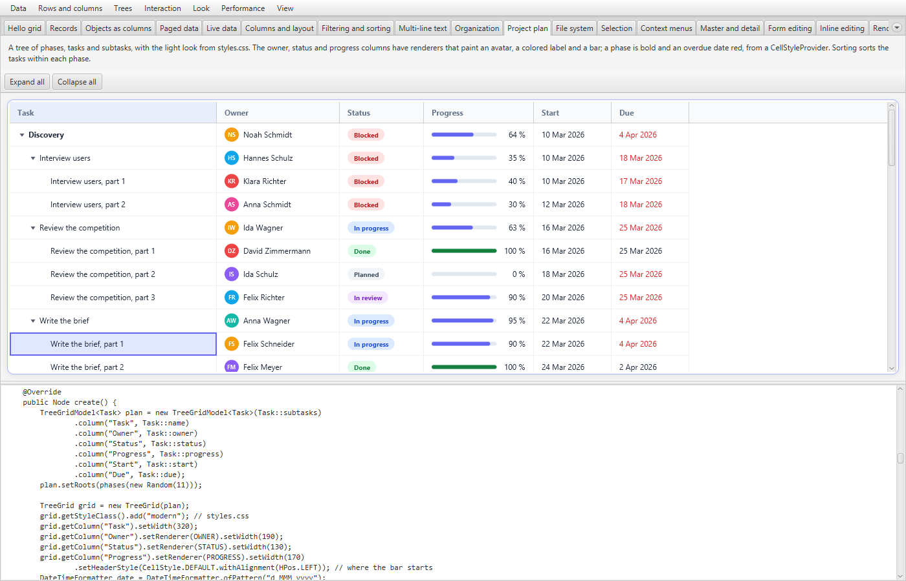

#  FX Grid

A JavaFX table control that paints all cells into one canvas. The scene graph is the same for ten rows or 100
billion cells (one `Canvas` and two `ScrollBar`s, 18 nodes including the scroll bar internals), and only the
visible cells cost time. 100 million rows scroll as fast as 100 million columns.

The grid shows a `GridModel`, a rectangle of values addressed by row and column, so the data can come from
anywhere. A list of objects is one of the ready-made models.

Status: MVP, version `0.1.0-SNAPSHOT`. The API may still change.



## Quick start

```java
ListGridModel<Person> people = new ListGridModel<Person>()
        .column("Name", Person::name)
        .column("City", Person::city)
        .column("Salary", Person::salary);
people.setAll(loadPeople());          // from any thread

Grid grid = new Grid(people);
```

Records, one column per component:

```java
Grid grid = new Grid(ListGridModel.ofRecords(Person.class, people));
```

Values from a function, any size without memory:

```java
Grid grid = new Grid(new ComputedGridModel(1_000, 1_000, (row, column) -> (row + 1) * (column + 1))
        .rowNames(row -> "y " + row)
        .columnNames(column -> "x " + column));
```

Reading what the user selected:

```java
List<Person> selected = people.getItems(grid.getSelectedModelRows());
grid.setOnCellAction(cell -> showDetails(people.getItem(cell.modelRow())));   // double-click or Enter
```

| Package | Contents |
|---|---|
| `de.schladebeck.fx.grid` | the control: `Grid`, `TreeGrid`, `GridColumn`, selection, layout |
| `de.schladebeck.fx.grid.model` | the data: `ListGridModel`, `ComputedGridModel`, `PagedGridModel`, `TreeGridModel` |
| `de.schladebeck.fx.grid.render` | painting cells and headers: `CellRenderers`, `CellStyle`, `TextMetrics` |
| `de.schladebeck.fx.grid.internal` | building blocks that scale to any size; not exported |

## Using it

The grid needs Java 25, JavaFX 25 and Maven 3.9. It is not published to a Maven repository yet. Install it with
`mvn install`, then:

```xml
<dependency>
    <groupId>de.schladebeck.fx</groupId>
    <artifactId>grid</artifactId>
    <version>0.1.0-SNAPSHOT</version>
</dependency>
```

In a modular application, require the module; it brings `javafx.controls` along. On the class path nothing else
is needed.

```java
module my.app {
    requires de.schladebeck.fx.grid;
    // only for ListGridModel.ofRecords and PagedGridModel.ofRecords: the grid reads the record components
    exports my.app.data to de.schladebeck.fx.grid;
}
```

## Data

| Model | Use it for |
|---|---|
| `ListGridModel<T>` | one object per row, one column per getter or record component |
| `ComputedGridModel` | values computed from row and column, such as generated or time-dependent data |
| `PagedGridModel<T>` | rows loaded in pages in the background when they come into view: databases, remote services |
| `TreeGridModel<T>` | a tree of items, shown in a `TreeGrid` |
| your own `GridModel` | anything else: objects as columns, arrays, a database cursor |

No manual refresh is needed: a model's changing methods tell the grid what changed. `ListGridModel.of(list)` also
shows an existing JavaFX `ObservableList` and follows it, whoever changes it: added and removed items, `set`,
sorting, and, for a list with an extractor, changes inside items:

```java
ObservableList<Employee> people = FXCollections.observableArrayList(e -> new Observable[] {e.salaryProperty()});
grid.setModel(ListGridModel.of(people).column("Name", Employee::getName).column("Salary", Employee::getSalary));
people.getFirst().setSalary(90_000);   // the row is painted again
```

Such a list is changed on the JavaFX application thread, as for any JavaFX control.

A model implements three methods; names and types have defaults:

```java
int getRowCount();
int getColumnCount();
Object getValueAt(int row, int column);   // asked only for visible cells
String getColumnName(int column);         // default: A, B, ..., Z, AA, ...
String getRowName(int row);               // default: null, the row header shows numbers
Class<?> getColumnClass(int column);      // default: Object.class, the renderer is picked per value
```

Rows and columns are symmetric, and each cell may hold a value of any type. A property sheet with one object per
column and one property per row is a small subclass of `AbstractGridModel`:

```java
GridModel model = new AbstractGridModel() {
    public int getRowCount() { return properties.size(); }
    public int getColumnCount() { return laptops.size(); }
    public Object getValueAt(int row, int column) { return values.get(row).apply(laptops.get(column)); }
    public String getRowName(int row) { return properties.get(row); }
    public String getColumnName(int column) { return laptops.get(column).name(); }
};
```

`AbstractGridModel` reports changes as `GridModelEvent`s for a range of model rows: `fireRowsInserted`,
`fireRowsDeleted`, `fireRowsUpdated`, `fireDataChanged` (any row, same columns) and `fireStructureChanged`.

### Threads

The grid reads its model on the JavaFX application thread. Data may change from any thread if the change goes
through `AbstractGridModel.applyChange`. On the JavaFX thread the change runs at once, before changes still
queued from other threads. From other threads it is queued, and queued changes run on the JavaFX thread in order,
in batches of about 8 ms, so input and painting go on while a background thread changes the model faster than
the screen can follow. Before the JavaFX toolkit has started, changes run at once on the calling thread.

The changing methods and builders of the ready-made models already do this (`ListGridModel.setAll`, `add`, `set`,
`update`, `removeRows`, ...; `ComputedGridModel.setSize`, `refresh`; `TreeGridModel.setRoots`;
`PagedGridModel.reload`). Own models wrap their changes:

```java
public void put(int row, int column, double value) {    // any thread
    applyChange(() -> {
        values[row][column] = value;
        fireRowsUpdated(row, row);
    });
}
```

Events fired from another thread are rejected with an exception. Updates of rows off screen cost nothing, rows
inserted above the visible area do not move the content, and all changes within one frame cost one repaint.

### Paged data

`PagedGridModel` asks a loader for pages of rows when cells of them are painted. The loader runs in the background
and may block, for example on a database query:

```java
PagedGridModel<Person> people = PagedGridModel.ofRecords(Person.class, rowCount, request ->
        repository.find(request.offset(), request.count(), request.sortColumns()));
```

Cells stay empty until their page arrives. Requests are served newest first, at most four at a time, so fast
scrolling loads what is on screen now; the 64 most recently used pages stay in memory. Sorting never loads all
rows: the model passes the sort order to the loader and drops its pages. Load errors go to `setOnLoadError`, and
`reload()` starts over.

## Compared with TableView

JavaFX's `TableView` makes a node for every visible cell and styles each one with CSS; the grid paints all cells
into one canvas. `TableView` is the more flexible control, the grid the faster one, for much larger tables.

| | FX Grid | TableView |
|---|---|---|
| Cells | painted by renderers: text, shapes, images | a node per visible cell, which can hold any control: buttons, combo boxes, charts |
| Nodes for a 1280×800 table | 18 | about 1,000 |
| Data | any `GridModel`: values by row and column from a list, a function, pages or any other source | an `ObservableList` of row objects and a value factory per column; JavaFX properties update their cells by themselves |
| Changes from other threads | queued and batched by `applyChange` | must be made on the JavaFX thread |
| Size | 100 million rows and 100 million columns, scrolling at the same speed | as many rows as the list holds; every column is an object with a header node, so wide tables get slower |
| Styling | table-wide CSS properties, styles per cell from code | full CSS per cell, row and column, with pseudo-classes such as `:selected` and `:odd` |
| Row heights | one row height, or a height per row from a provider | each row as high as its content |
| Columns | frozen columns and rows, a row header, fitted to the data when it arrives, a column menu, zoom | a menu button to show and hide columns, resize policies that fill the width |
| Nested column headers | rows of groups from one function per row, for any number of columns; only shown, columns move one by one | nested columns that move together |
| Sorting | several columns (Shift+click), a comparator per column, or done by the model, for example a database | several columns (Shift+click), through a `SortedList` |
| Filtering | built in (`setRowFilter`) | through a `FilteredList` |
| Selection | cells, rows, whole columns, several rectangles | rows, or cells and ranges of cells |
| Copying, saving the layout | Ctrl+C as tab-separated text; `getLayout()` as one string | not built in |
| Editing | a text field with converters, check boxes; editing in a form is recommended | editor cells for text, check boxes, choice and combo boxes, or any custom editor |
| Trees | `TreeGrid` with a `TreeGridModel`: expanding inserts rows, collapsing deletes them | `TreeTableView` |
| Dragging rows | no | through a row factory |
| Text | cut by cached character widths, so complex scripts may be cut slightly off | text nodes with exact layout |
| Right to left, accessibility | left to right only; reported as a table, not yet tested with a screen reader | both, proven |
| Maturity | version 0.1 | part of JavaFX since 2011 |

Use `TableView` for controls inside cells, CSS per cell, rows as high as their content, right-to-left layouts,
or where proven accessibility matters. Use the grid for large, wide or live data, for data that is not a list of
objects, and for spreadsheet-like work: selecting areas, copying, frozen rows, columns and row headers. The measured
differences are in [Grid and TableView measured](#grid-and-tableview-measured).

## Showcase

The `grid-showcase` module has one page per example, picked with the buttons at the top or the menus, both grouped
by category, with three trees (an organization, a project plan, a file system that makes folders when they open).
Ctrl+Tab and Ctrl+Shift+Tab cycle through them, and View > Source code (Ctrl+U) shows the example's source with its
imports, followed by the files it uses (`Person`, `SampleData`, and `styles.css` for the examples with a light or
dark look of their own) and the `Example` base class. Only the selected example runs. From the project folder:

```bash
mvn compile javafx:run
```

Frames are held back to the screen's refresh rate (vsync), so the performance examples show at most 60 frames per
second on a 60 Hz screen. View > Frames at the screen's rate starts the showcase again without vsync, on the same
example; from the command line, `mvn compile javafx:run -Djavafx.args=--no-vsync` or
`java -jar fx-grid-showcase.jar --no-vsync`. The update stress test then shows about 490 instead of 60 on the laptop
described under [Performance](#performance).

`mvn package` also builds `grid-showcase/target/fx-grid-showcase.jar`, the showcase with the grid and JavaFX in
one file, started with `java -jar fx-grid-showcase.jar`. It needs Java 25 and runs only on the operating system
it was built on, because it contains that system's JavaFX native libraries.

## API documentation

The generated Javadoc is in [`docs/api`](docs/api/index.html). Its package overview explains the concepts and has
the [full CSS reference](docs/api/de.schladebeck.fx.grid/de/schladebeck/fx/grid/package-summary.html#css-reference-heading).
Regenerate it after a build with `bash docs/generate-api-docs.sh`.

## Performance

`ScrollBenchmark` scrolls a grid styled like an application (frozen columns, a row header, cells in other fonts,
two-line headers) through eight scenarios with vsync off, prints the frame rate of each and exits. Its arguments
are `--width=1280 --height=800 --rows=100000000 --columns=1000 --style=styled|plain`; `plain` leaves the styling
out.

```bash
mvn compile javafx:run -Dapp=ScrollBenchmark
```

On a laptop with integrated graphics (AMD Radeon 890M), 1280×800 window at 200% scaling (2560×1600 physical
pixels), time per frame, measured on 4 October 2026 with the current build:

| Scenario | 100,000,000 rows × 1,000 columns (ms) | 1,000 rows × 100,000,000 columns (ms) | 100,000,000 rows, plain (ms) |
|---|---:|---:|---:|
| vertical scroll | 1.32 | 1.40 | 1.37 |
| horizontal scroll | 1.32 | 1.39 | 1.30 |
| diagonal scroll | 1.36 | 1.24 | 1.23 |
| 1,000 rows per frame | 1.41 | 1.27 | 1.30 |
| 1,000 columns per frame | 1.18 | 1.20 | 1.25 |
| vertical scroll, zoom 50% | 2.48 | 2.84 | 2.42 |
| vertical scroll, zoom 200% | 1.18 | 1.16 | 1.17 |
| 1,000 cell updates per frame | 1.29 | 1.41 | 1.30 |

The first two columns use the styled grid. The plain one leaves out cell styles, fonts and the header renderer,
which make no measurable difference.

A 60 Hz display allows 16.7 ms per frame. The same laptop measured anywhere from about half to the full numbers
above on different runs of the day, depending on its power state, so treat them as an order of magnitude. The FX
thread needs well under a millisecond per frame; the time goes to the render thread drawing glyphs and rectangles
and presenting the frame. The cost depends on the number of visible cells, not on the model's size or shape.

Changes of the data, on the same laptop, through the public API:

| Change | Time |
|---|---:|
| Live feed into a view sorted by a number, 1,000,000 rows: 5 inserted and 5 updated rows per frame | 0.75 ms per frame |
| Sorting 1,000,000 rows by a number | 45 ms |
| Sorting 1,000,000 rows by text, values repeat | 0.14 s |
| Sorting 1,000,000 rows by text, every value differs | 0.81 s |
| Sorting 1,000,000 rows by text that repeats, then by text that differs | 0.35 s |
| Moving a column among 100,000,000 columns | 0.5 ms |

`RendererBenchmark` measures what drawing in a renderer costs (see [Renderers](#renderers)):

```bash
mvn compile javafx:run -Dapp=RendererBenchmark
```

The showcase's Benchmarks page starts either benchmark in a process of its own and lists its results.

Performance is easy to lose with new features, so compare builds before a release: run `ScrollBenchmark` and
`TableViewComparison` from the previous build and the new one, one after the other on the same machine. Results
made hours apart are not comparable, since the laptop's own speed changes that much. A check box drawn as a path
once halved the frame rate this way, unnoticed by every test.

### Grid and TableView measured

Both controls with the same data in the same 1280×800 window, measured with `TableViewComparison` on the laptop
above, on the same day. `TableView` used its fast setup: a fixed cell size and its default text cells. The grid
formats numbers and paints check boxes, so it does a little more per cell.

| | FX Grid | TableView |
|---|---:|---:|
| Scrolling 1,000,000 rows × 20 columns | 773 fps | 177 fps |
| Scrolling the same sideways | 783 fps | 160 fps |
| Jumping 1,000 rows per frame | 826 fps | 87 fps |
| 1,000 row updates per frame | 815 fps | 34 fps |
| Scrolling 100,000,000 rows (TableView over a list that computes its rows) | 738 fps | 164 fps |
| Scrolling 10,000 rows × 1,000 columns sideways | 731 fps | 78 fps |
| Showing 1,000,000 rows | 7 ms | 92 ms |
| Memory for a sorted and filtered view of 1,000,000 rows | 9 MB | 58 MB |
| Sorting 1,000,000 rows by a number | 46 ms | 1.1 s |
| Sorting 1,000,000 rows by text (names, which repeat) | 76 ms | 6.6 s |
| Filtering 1,000,000 rows | 28 ms | 0.98 s |
| Live feed into a sorted view of 1,000,000 rows, 5 new and 5 changed rows per frame | 1.4 ms per frame | 56 ms per frame |
| Selecting all of 1,000,000 rows | 1.2 ms | 1.3 s |
| Clearing a selection of 80,000 rows | 0.2 ms | 2.4 s |

Frame rates are measured with vsync off. A 60 Hz screen shows at most 60, so a rate above that is spare time.
`TableView` falls below 60 with 1,000 row updates per frame, and below 20 with the live feed into a sorted view.
When it sorts, it reads both values again through the value factory for every comparison. Its time to clear a
selection grows with the square of the selected rows, to minutes for 1,000,000. The table shows one run;
`TableView`'s times for operations varied by up to a factor of two between runs, the grid's by much less. Run the
comparison yourself:

```bash
mvn compile javafx:run -Dapp=TableViewComparison
```

## Concepts

### Rows and columns: view and model

Rows and columns both have a view order (as shown) and a model order (as in the data):

| | Rows | Columns |
|---|---|---|
| Leave some out | `setRowFilter(condition)` | `getColumn(column).setVisible(false)` |
| Reorder | `sort(column, ascending)`, `sort(List<SortKey>)` | `moveColumn(from, to)` |
| Names | `GridModel.getRowName` | `GridModel.getColumnName` |
| Size | `setRowHeightProvider(...)` | `getColumn(column).setWidth(...)`, auto-fit |
| Size limits | `setMinRowHeight`, `setMaxRowHeight` | `getColumn(column).setMinWidth(...)`, `setMaxWidth(...)` |
| View to model | `viewToModelRow(row)` | `viewToModelColumn(column)` |
| Model to view (-1 if not shown) | `modelToViewRow(row)` | `modelToViewColumn(column)` |
| Count shown | `getViewRowCount()` | `getViewColumnCount()` |

Positions use view indices: the selection, `cellAt`, `getCellBounds`, `scrollTo`, `getViewValueAt`.
Configuration and data use model indices: `getColumn`, sorting, `getSelectedModelRows`,
`getSelectedModelColumns`, `forEachSelectedCell`, `selectModelRow`. `GridCell`, passed to the cell action, the
context menu factory and the tooltip provider, carries `viewRow`, `viewColumn`, `modelRow`, `modelColumn` and the
value.

`getColumn(modelColumn)` or `getColumn(name)` returns a `GridColumn`, a handle for one column whose setters chain.
It belongs to the model the grid showed when it was taken; once the grid shows another model, its methods throw
`IllegalStateException`.

```java
grid.getColumn(0).setWidth(80).setMinWidth(40).setMaxWidth(120);
grid.getColumn("Salary").setRenderer(CellRenderers.number("#,##0.00"));
grid.getColumn("Name").setComparator(Collator.getInstance());   // sorting
grid.getColumn("Born").setConverter(new LocalDateStringConverter()); // in-place editing
grid.getColumn("ID").setPrototypeValue(99_999_999);               // fitting before data arrives
grid.getColumn(5).setVisible(false);
```

### Renderers

A `CellRenderer` paints one cell onto the canvas. One instance serves all cells, so it must be stateless. The
background and the selection are painted before it, grid lines after it. Each renderer starts with the canvas
reset to the cell font, the text fill, left aligned and vertically centered text, full opacity, a line width of 1
and no effect. A renderer that throws leaves its cell empty; the grid logs the first exception of each kind and
keeps painting.

What a renderer draws decides the frame time. With about 850 cells on screen, rectangles, lines, ovals, rounded
rectangles and images cost nothing measurable, text 0.5 ms per frame, a clip about 0.5 ms more, a polygon 1.3 ms, a
path 2.9 ms, a polyline of 10 points 4.6 ms (the sparkline is one), an effect such as a drop shadow over 30 ms. The
`CellRenderer` documentation has the measurements, and `RendererBenchmark` repeats them. A renderer cannot hold
JavaFX nodes: the grid is one canvas. Draw a picture of a node instead, taken once per value with `snapshot` and
drawn with `drawImage`, and use editing, the cell action, context menus or a node in the tooltip for interaction.

```java
grid.getColumn(2).setRenderer((gc, cell) -> {
    if (cell.getValue() instanceof Double progress) {
        gc.setFill(Color.web("#1a7f37"));
        gc.fillRect(cell.getX() + 6, cell.getY() + 7, (cell.getWidth() - 12) * progress, cell.getHeight() - 14);
    }
});
```

Besides value, bounds and style, the `CellContext` has the view and model position (`getViewRow`,
`getModelRow`, ...), `indent(width)` to reserve room at the left for an icon or a tree's indentation, and
`isEditable()`.

The grid picks the renderer per cell, first match wins:

1. the `CellRendererProvider`, if set and it returns one: `(modelRow, modelColumn, value) -> renderer`
2. the column's renderer, `getColumn(column).setRenderer(renderer)`
3. the default renderer for the column class, if the model declares one
4. the default renderer for the value's class, `setDefaultRenderer(type, renderer)`
5. text

Built-ins: `CellRenderers.TEXT`, `NUMBER` (right aligned, in the format of the default locale, with as many decimals
as the numbers on screen in the column need so they line up, `###` when it does not fit), `BOOLEAN` (a check box,
muted where the cell cannot be edited), `WRAPPED_TEXT`, `PROGRESS`, and the factories `number("#,##0.00")`,
`number(pattern, locale)`, `format(format)`, `format(format, alignment)`, `text(value -> ...)`, `progress(color)` (a
bar for values from 0 to 1 with the percentage), `dataBar(min, max, color)` (a bar behind the number, like Excel's
data bars), `badge(colorOf)` and `badge(textOf, colorOf)` (a label with round ends, for a status) and
`sparkline(color)` (a small line chart of a `double[]` or a list of numbers). Text drawn through `drawText`,
`drawWrappedText`, `CellContext.fitText` or `CellContext.wrapText` is shortened with "…", gets a tooltip with the
full text, and counts when the column is fitted.

### Column headers

Headers are painted like cells. A header style sets background, text color, font, weight, posture and alignment
for one column; a header renderer paints the content, for one column or for all, which also serves 100 million
columns. Its context has the column name as value and row -1. The grid paints the background before it and the
sort arrow after it, so custom headers still show the sort order. By default the name is aligned like the
column's values: right above numbers, centered above booleans, left otherwise. An alignment in the header style,
or a header renderer of its own, wins.

```java
grid.getColumn(6).setHeaderStyle(CellStyle.DEFAULT.withBackground(Color.web("#24292f"))
        .withTextFill(Color.WHITE).withAlignment(HPos.RIGHT));
grid.setStyle("-grid-header-height: 4em;");     // two lines, grows with the font
grid.setHeaderRenderer((gc, cell) -> {          // all headers: the name, and the type below it
    double x = cell.getX() + cell.getPadding();
    Font small = Font.font(cell.getFont().getSize() * 0.85);
    gc.fillText(cell.fitText((String) cell.getValue()), x, cell.getY() + cell.getHeight() / 3);
    gc.setFont(small);
    gc.fillText(cell.fitText(typeOf(cell.getModelColumn()), small), x, cell.getY() + cell.getHeight() * 2 / 3);
});
```

CSS is applied when the grid is first laid out, so `grid.getFont()` or `grid.getRowHeight()` still return the
defaults while the grid is being built. Read them inside renderers, providers and listeners, and give sizes that
depend on the font in `em`, as above.

### Row heights and multi-line text

All rows have the row height unless a `RowHeightProvider` gives them another, kept between the minimum and
maximum row height. Only the exceptions are stored. `TextMetrics` measures text with the grid's own rules:

```java
grid.getColumn(NOTES).setRenderer(CellRenderers.WRAPPED_TEXT);
grid.maxRowHeightProperty().bind(Bindings.createDoubleBinding(       // four lines in the current font
        () -> 4 * TextMetrics.lineHeight(grid.getFont()) + 8, grid.fontProperty()));
grid.setRowHeightProvider(row -> {
    int lines = TextMetrics.lineCount(notes(row), grid.getFont(), grid.getColumn(NOTES).getWidth() - 12);
    return lines * TextMetrics.lineHeight(grid.getFont()) + 8;
});
```

The provider is asked for every row when the rows are sorted or filtered, when the row height or a column width
changes, and on `refreshRowHeights()`. When up to 1,000 rows are inserted or deleted at once, the stored heights
move along and only the new rows are measured; updated rows are measured again on their own.

### Columns and layout

The first 100 columns without an explicit width are fitted to their header and the first 50 rows when data
arrives, at most 320 pixels wide; a paged model is fitted once its first page has arrived. They are fitted again
when the font or the cell padding changes, for example with the theme. Such a column also widens when sorting puts
the arrow next to a header that no longer fits, and a `TreeGrid` widens its tree column for the children of an
item the user opens. Columns resized by the user or with `GridColumn.setWidth` keep their width.
`setAutoFitColumns(false)` turns fitting off, and `fitVisibleColumns()` fits what is on screen. A prototype value
is measured too, so an ID column is wide enough before the large IDs arrive. Every width stays within the column's
minimum (default 20) and maximum.

`setFrozenColumnCount(n)` keeps the first `n` view columns in place when scrolling sideways, and
`setFrozenRowCount(n)` the first `n` view rows below the column header when scrolling down. Both count view
positions, so after sorting the first rows of the new order stay in place.

The user's arrangement (column order, widths, hidden columns, sort, frozen columns and rows, zoom) can be saved
whenever it changes:

```java
grid.setLayout(GridLayout.decode(preferences.get("grid", "")));    // nothing saved yet: decode gives null, no change
grid.setOnLayoutChanged(layout -> preferences.put("grid", layout.encode()));
```

`encode()` writes a string such as
`v=1;order=3,0-2;widths=1:150;hidden=2;sort=3:desc;frozen=1;frozenRows=0;zoom=1;names=0:ID,1:Name,2:City,3:Salary`.
It holds
only what differs from the default (the column order as ranges, widths the user or code set), so it stays short
for 100 million columns. The names let a saved layout find its columns after columns were inserted into the
model; what it cannot find is left out. `setLayout` clears the selection.

### Sorting and filtering

`setRowFilter(condition)` shows only the model rows the condition accepts. `RowFilters.containsText(model, text)`
searches all columns, and `ListGridModel.matching(condition)` tests the items.

A click on a column header sorts by that column: ascending, descending, unsorted. A plain click on a column of a
sort by several columns makes it the only sort column and continues from its direction. Shift+click adds a column
to the sort, and on a column already in it switches to descending or, from descending, takes it out; the header
shows the arrow and the column's place in the order. The second click of a double-click does not sort again.
When the grid is not sortable (`setSortable(false)`) or the selection mode is `COLUMN`, a header click selects the
column instead, and Ctrl+click adds it. In code:

```java
grid.sort(List.of(new SortKey(department, true), new SortKey(salary, false)));
grid.sort(salary, false);                                       // one column
grid.sortKeysProperty().addListener((o, old, keys) -> status.setText("Sorted by " + keys));
```

The sort is stable, and later keys only order the ties of earlier ones. Text sorts case-insensitively unless the
column has its own comparator. Sorting and filtering keep the selection on its rows. Inserted rows are placed by
their values at once; rows whose values change keep their place until `refreshView()` filters and sorts again.

A model that sorts better itself, such as a database query, overrides
`GridModel.sortRows(List<SortKey> keys, IntFunction<Comparator<Object>> order)` and returns `true`. `order` gives
each column's order of values: its comparator, or the grid's default. `PagedGridModel` passes the keys to its
loader, and `TreeGridModel` sorts the children of each item among themselves. After a model sorted itself the
grid clears the selection, because the rows have new numbers.

### Column groups

```java
grid.setColumnGroups(List.of(
        column -> column == 0 ? null : column < 5 ? "Person" : "Employment",
        column -> column < 6 ? null : "Contract"));
```

Each `ColumnGroup` is a function `String nameOf(int modelColumn)` for one row of group names above the column
headers, from the top; `null` means no group. Neighbouring columns with the same names share one cell, and a
column without a group further down gets a taller header. A function costs nothing per column, so groups work for
100 million columns too. Groups are only shown: columns are still moved one by one, and a column moved out of its
group splits it. Cut-off group names show a tooltip.

### Trees

```java
TreeGridModel<Unit> company = new TreeGridModel<Unit>(Unit::children)
        .column("Name", Unit::name)
        .column("People", Unit::people);
company.setRoots(List.of(headquarters));
Grid grid = new TreeGrid(company);
```

Every item is a row, and the children of an expanded item follow it. The children function is called when an
item is first shown with its triangle; `hasChildren(predicate)` decides the triangle without it, for children that
load slowly. Each item keeps its own expanded state, also while its parent is collapsed, and `setRoots` keeps
items expanded that equal items expanded before. Expanding inserts rows and collapsing deletes them, so selection
and scroll position behave as with any other change. Sorting sorts the children of each item among themselves.

A `TreeGrid` indents the first column by depth and draws the triangles; the column keeps its renderer, moved right
with `CellContext.indent`. A click on a triangle opens or closes an item, and so does a double-click if the grid
has no cell action and is not editable. The keys are in [Keyboard and mouse](#keyboard-and-mouse). Screen readers
get each item's level and expanded state.

### Menus, tooltips and placeholder

The column header has a built-in menu, opened by a right-click or Alt+Down. "Sort ascending" and "Sort descending"
show the column's direction; on a column among several sort columns they change its direction in place, otherwise
the column becomes the only sort column. "Add to sort" appears while other columns are sorted, "Clear sorting"
while two or more are, and "Remove sort" takes the column out. Further items fit or hide the column and fit the
visible columns. A check box per column shows or hides it: a click anywhere on its row or Enter toggles it, and
the menu stays open. With more than 100 columns, one item shows all hidden columns instead.

`setColumnMenuFactory` replaces the menu (`grid.createColumnMenu(column)` builds the default one, to extend it),
and `setColumnMenuEnabled(false)` turns it off. Cells get a menu from a factory, which sees the clicked cell and
may return `null` for no menu:

```java
grid.setCellContextMenuFactory(cell -> {
    MenuItem filter = new MenuItem("Only " + cell.value());
    filter.setOnAction(e -> grid.setRowFilter(
            row -> Objects.equals(model.getValueAt(row, cell.modelColumn()), cell.value())));
    return new ContextMenu(filter);
});
```

A right-click outside the selection selects the clicked cell first, so menu actions can work on the selection.
The context menu key opens the menu below the focused cell.

Cut-off cells, headers and row names show their full text as a tooltip; `setTooltipProvider(cell -> ...)` gives
any cell a text of its own, and `setTooltipGraphicProvider(cell -> node)` a node such as a small chart or a few
labels, asked once each time the mouse enters a cell. The tooltips have the style class `grid-tooltip`, so CSS
sets their look and timing (`-fx-show-delay`). While no rows are shown, the grid shows "No rows", or the node set with
`setPlaceholder(node)`; `setPlaceholder(new Region())` shows nothing. The grid's own texts (menus, messages) are
English or German, following the default display locale, `Locale.getDefault(Locale.Category.DISPLAY)`.

### Styling

Table-wide settings are CSS properties on the `.grid` style class. Their defaults come from the Modena theme
variables and the font the grid inherits, so a dark theme or a larger font on `.root` reaches the grid without
any `-grid-*` property:

```css
.root {
    -fx-base: #3c3f41;
    -fx-control-inner-background: #1e1f22;
    -fx-accent: #2675bf;
    -fx-font-size: 14px;
}
```

| Property | Default | Paints |
|---|---|---|
| `-grid-font` | the inherited `-fx-font` | cell text |
| `-grid-header-font` | the inherited `-fx-font`, bold | header text |
| `-grid-text-fill` | `-fx-text-inner-color` | cell text, check boxes |
| `-grid-cell-background` | `-fx-control-inner-background` | cells |
| `-grid-alternate-cell-background` | `-fx-control-inner-background-alt` | every other row; `null` turns striping off |
| `-grid-alternate-column-background` | none | laid over every other column; see-through colors combine with the row stripes |
| `-grid-line-color` | the cell background, a little darker (light themes) or lighter (dark themes) | grid lines; a shade stronger after the frozen columns and rows and in the header |
| `-grid-selection-background` | a neutral gray; while focused a tint of `-fx-accent`, light on light themes, dark on dark ones | selected cells, mixed into the headers of selected rows and columns |
| `-grid-focus-color` | `-fx-focus-color` | while focused: the focused cell's border and the selection's outline; the column drop marker |
| `-grid-header-background` | `-fx-base` | row and column header |
| `-grid-header-text-fill` | `-fx-text-base-color` | header text, sort arrow |
| `-grid-row-height` | `2em` (24 at font size 12) | rows without their own height |
| `-grid-header-height` | `2.333333em` (28) | column header |
| `-grid-cell-padding` | `0.5em` (6) | space left and right of the text in a cell |

- Colors may use theme variables, your own variables and `derive(...)` or `ladder(...)`.
- Fonts take the shorthand (`-grid-font: 14px "Segoe UI";`) or single parts such as `-grid-font-size`; missing
  parts come from the inherited font.
- To make text larger, set `-fx-font-size` on `.grid` or `.root`: fonts, row height and padding grow together.
- `.grid:focused` holds the look while the grid has the keyboard focus: the selection turns from gray to the
  accent color, and the grid gets the same focus ring as `TableView`.
- Other selectors: `.grid .scroll-bar` for the scroll bars, `.grid > .grid-editor` and `:invalid` for in-place
  editing.
- An inline style beats a stylesheet, a stylesheet beats a value set in code, and code beats the defaults.

Per-cell styling comes from a `CellStyleProvider`. It runs for every visible cell on every repaint, so it
returns shared constants:

```java
CellStyle negative = CellStyle.DEFAULT.withTextFill(Color.web("#c62828")).withFontWeight(FontWeight.BOLD);
CellStyle code = CellStyle.DEFAULT.withFont(Font.font("Monospaced", 12));
grid.setCellStyleProvider((modelRow, modelColumn, value) ->
        modelColumn == 0 ? code : value instanceof Double d && d < 0 ? negative : null);
```

`withFontWeight` and `withFontPosture` change only the weight and posture of the font the cell would have, so
bold and italic cells keep the grid's font size when the theme changes it. `withFont` sets a whole font as given.

### Selection and copying

| `SelectionMode` | Click | Shift+click | Ctrl+click |
|---|---|---|---|
| `SINGLE_CELL` | the cell | moves the selection | moves the selection |
| `ROW` | the whole row | extends rows | adds rows |
| `COLUMN` | the whole column | extends columns | adds columns |
| `AREA` (default) | the cell | extends the rectangle | adds a rectangle |

The selection is a list of ranges, so a million selected rows are one range. Inserted and deleted rows move the
ranges, also in a sorted or filtered view, where up to 1,000 rows at once are followed and more are remapped like
a sort. A row inserted inside a selected range is selected too. Sorting and filtering keep the selected rows and
the focused cell for up to 100,000 selected rows. Moving or hiding columns keeps only whole-row selections.
While the grid has the focus, the focused cell of a larger selection keeps its normal background (except in `ROW`
mode), so it stands out.

`focusedModelRowProperty()` follows the focused row, for a detail view next to the grid. `selectModelRow(row)`
selects a data row wherever it is shown and scrolls to it, for example after adding an item.
`forEachSelectedCell` visits each selected cell once, row by row in view order, each row left to right.

Ctrl+C or `copySelection()` copies the selected cells as tab-separated text, each cell as it is shown. Several
ranges are copied together when they span the same columns (such as rows picked with Ctrl+click) or the same
rows. Otherwise, or beyond 1,000,000 cells, Ctrl+C shows a message instead.

### Editing

Editing in a form next to the grid is the recommended default: the grid stays read-only, the form edits the
selected item, and saving replaces the item in the model. Where editing inside the table fits better, give
columns an update function and switch editing on. Own models implement `isCellEditable` and `setValueAt`.

```java
ListGridModel<Person> people = new ListGridModel<Person>()
        .column("Name", Person::name, Person::withName)
        .column("Salary", Person::salary, Person::withSalary);
grid.setEditable(true);
```

Typing a character on the focused cell starts editing with that character; double-click, Enter or F2 start with
the cell's value. Enter commits, Tab commits and edits the next cell (Shift+Tab the previous one; check boxes are
only moved to, not toggled), and Escape cancels. Text is converted back with the column's converter
(`GridColumn.setConverter`), or else as a number in the format of the default locale, a date, a time, an enum
constant or a boolean; columns of other types are not edited in place. Text that cannot be converted stays in the
field with a message that gives the old value as an example; a value the model rejects stays with the model's
message. A click on a check box, or Space, toggles it.

### Accessibility

The grid reports itself as a table to screen readers and UI test tools: row and column counts, the column
headers, the focused and the selected cells with their position and the text they show. Because the cells are not
nodes, the grid creates invisible placeholder nodes on demand, only while assistive technology asks, and keeps at
most 32 of them.

## Keyboard and mouse

| Input | Action |
|---|---|
| Arrow keys | move the focus; with nothing focused, the first key focuses the top left cell on screen |
| Shift+arrow keys | extend the selection |
| Ctrl+arrow keys | jump to the first or last row or column |
| Page Up, Page Down | move by one page |
| Home, End | first or last column; with Ctrl first or last cell |
| Enter, double-click | cell action, or edit when editable |
| F2, typing a character | edit the focused cell when editable |
| Tab, Shift+Tab | while editing: commit and edit the next or previous cell |
| Escape | cancel editing or moving a column |
| Space | toggle a check box when editable |
| Shift+Space, Ctrl+Space | select the focused row or column |
| Ctrl+A | select all (not in single cell mode) |
| Ctrl+C | copy the selection as shown |
| Ctrl+Plus, Ctrl+Minus, Ctrl+0 | zoom in, zoom out, reset |
| Ctrl+mouse wheel, pinch | zoom around the mouse position |
| Shift+mouse wheel | scroll horizontally |
| Click a column header | sort ascending, descending, unsorted; select the column when not sortable or in column mode |
| Shift+click a column header | add the column to the sort; again: descending, then out of the sort |
| Drag a column header | move the column |
| Drag a column header border | resize the column |
| Double-click a column header border | fit the column to its content |
| Right-click the column header, Alt+Down | column menu |
| Right-click a cell, context menu key | cell context menu, if a factory is set |
| Click or drag in the row header | select rows |
| Drag beyond the edge | scroll while selecting or moving a column |
| Click the top left corner | select all |
| Right or +, Left or - in a `TreeGrid` | expand; collapse, or on a collapsed item go to its parent |
| Right on an expanded item in a `TreeGrid` | go to its first child (row selection mode) |
| Click a triangle in a `TreeGrid` | expand or collapse |

## Architecture

`Grid` is a facade composed of small parts, most with their own tests:

| Package | Class | Job |
|---|---|---|
| `grid` | `Grid`, `GridColumn` | the public API; `GridColumn` forwards to the grid |
| | `GridSelectionModel` | ranges, anchor and focus, selection modes, adjusting to inserted and deleted rows |
| | `ColumnSettings` | column settings outside the layout (header style, comparator, converter, ...), only for columns that have any |
| | `GridSkin` | the nodes, layout, scroll bars, row positions, auto-fit, one repaint per pulse |
| | `GridGeometry` | viewport math: visible range, positions, hit testing, snapping, scroll targets |
| | `GridPainter` | paints cells and headers through one reused `CellContext`, remembers cut-off text, measures columns |
| | `GridBehavior` | mouse, keyboard, scroll, zoom and auto-scroll |
| | `ColumnMenu`, `Texts` | the column menu and the translated texts |
| | `RendererRegistry` | the default renderer per cell, cached without arrays per column |
| | `CellEditor`, `ValueParser` | the in-place editor and its default text conversion |
| | `AccessibleCell` | the placeholders for assistive technology |
| | `TreeGrid` | the tree column's indentation and triangles, and the input that opens and closes items |
| `internal` | `ViewRows`, `IndexMap` | view rows to model rows (filter, sort, or the model's own sort), updated in place for inserted and deleted rows |
| | `RowSorting` | the sorts: radix sort for numbers, ranks for repeated values, folded text |
| | `Spans` | positions of rows and columns: a default size plus the exceptions |
| | `ColumnLayout` | column order as runs of model columns, visibility, widths and limits |
| | `TextFitter` | text widths from character advances cached per font |
| `model` | `AbstractGridModel` | listeners and the handoff of changes to the JavaFX thread |
| | `ItemColumns` | column definitions shared by `ListGridModel`, `PagedGridModel` and `TreeGridModel` |

The skin stays in the main package because it uses package-private parts of `Grid`. `internal` is not exported,
so its public classes are not API. Every structure that grows with the number of rows or columns stores only the
exceptions to a default (widths, heights, hidden columns, a moved column order, renderers per column), so a grid
with 100 million untouched columns holds a handful of objects.

Model events, scrolling and property changes only mark the grid dirty. The next layout pass fits columns if needed,
updates the geometry and the scroll bars, and repaints the canvas once. The painter paints the scrolled cells, then the
frozen columns, the frozen rows and the headers on top of them, so nothing is clipped (canvas clipping cost up to 45% of
a frame in early measurements). Within a region it paints all backgrounds, then the renderers column by column, then the
lines, so the canvas changes its state rarely. Positions are snapped to device pixels, and character widths are cached
per font because JavaFX has no public font metrics API.

An early prototype compared `Canvas` with Java2D drawing into a `PixelBuffer`, including shifting existing
pixels on scroll. `Canvas` was about twice as fast on a high-DPI screen, kept the FX thread almost idle, and
renders text exactly like the rest of JavaFX. The whole canvas is repainted each frame: on the laptop above a
frame takes 1.2 to 1.4 ms in all, even with 1,000 cell updates per frame, and scrolling changes every pixel anyway.
Changes to rows off screen do not repaint at all.

## Known limitations

- Accessibility is tested through the JavaFX accessibility API, not yet with a real screen reader.
- Auto-fit looks at the first 50 rows of the first 100 columns. Much longer values further down (such as large
  IDs) are cut off with a tooltip until the column is fitted again or given a width or minimum width.
- Sorting and filtering run on the FX thread over the whole model unless the model sorts itself (times in
  [Performance](#performance)). Values that change later do not move rows or re-run the filter until
  `refreshView()`, a new filter or sort, or the model replacing all its rows.
- A selection over more than 100,000 rows is cleared when the rows are sorted or filtered, or when more than
  1,000 rows at once are inserted into or deleted from a sorted or filtered view.
- A row height provider is asked for every row on each sort or filter and when more than 1,000 rows are
  inserted or deleted at once; for millions of rows that takes several milliseconds.
- The grid is always laid out left to right, also in a right-to-left scene.
- Column groups are only shown: they do not move as a whole, and their names do not widen columns.
- A row filter on a `TreeGrid` tests each row on its own, so a child can be shown without its parent.
- Filtering a `PagedGridModel` would need all rows; filter in the loader's query and call `reload(rowCount)`.
- Text width is the sum of cached character widths. Kerning, ligatures and complex scripts can make the
  ellipsis position or line breaks slightly off.
- Prism limits textures to 4096 pixels by default. A grid wider or taller than that in physical pixels (for
  example full screen on a 5K display) cannot allocate its canvas.

## Roadmap

- Tiling the canvas for viewports beyond the texture limit
- Named cell styles defined in CSS
- Fitting a column to rows further down, in the background

## Project layout

```
grid/                    the control, module de.schladebeck.fx.grid
grid-showcase/           showcase app, examples and benchmarks
docs/                    API documentation, images and the script that generates the API docs
```

`mvn verify` builds and tests everything. Some tests start the JavaFX toolkit and need a display.

## License

Not decided yet.
